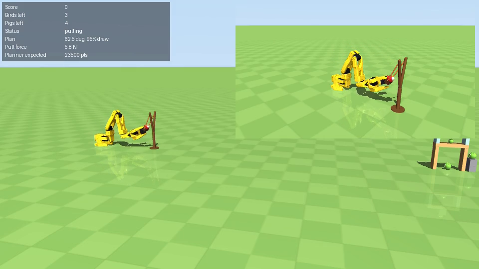

# Angry Birds RL: an SO-101 robot arm that learns to shoot

A physics-faithful Angry Birds environment (Box2D, the engine the original
game uses) driven by the slingshot from the "Angry Birds, with real physics"
reel: 4 latex tubes modelled with an Ogden fit to Treloar's rubber data,
212 J stored, ~21 m/s launch. Part 1 (this repo, done) is the game
environment. Part 2 trains a robot arm in MuJoCo Playground to fire it.


## How it all runs together

```
                ROBOT SIDE (Part 2: MuJoCo Playground, GPU)        GAME SIDE (Part 1: Box2D, CPU)
 level obs ──►  π_aim(level) → target shot (angle, speed)
                π_arm(joints, target) → joint torques @ 50 Hz
                grip pouch → pull back → hold → release           bird flies (gravity [+ drag])
                Ogden bands accelerate pouch + bird        ────►  hits blocks → contact impulses → damage
                                                 release x,y,vx,vy blocks/pigs break → Angry Birds score ──► reward
```

The only thing the arm hands to the game is the bird's release position and
velocity (`angrybirds.slingshot.Launch`). The two simulators can use whatever
engine and hardware suits them:

1. **Reset:** load a level (starter or generated), settle it, freeze it asleep.
2. **Aim:** a policy picks a target (angle, power).
3. **Fire:** in Stage A the slingshot model turns that straight into a
   `Launch`. In Part 2 the MuJoCo arm pulls, holds and releases, and its
   measured release state becomes the `Launch`.
4. **Simulate:** `GameWorld.shoot()` runs until everything is at rest. Contact
   impulses become damage, and broken blocks and pigs score points.
5. **Reward:** the shot's points. With 3 birds, the next shot sees the damaged
   level.

## Watch it live: SO-101 in MuJoCo



```bash
pip install -r requirements.txt
python scripts/live.py --level L3_reel_tower            # Linux / Windows
mjpython scripts/live.py --level L3_reel_tower          # macOS
python scripts/live.py --level L4_fortress --shot 45,0.9 --slowmo 3   # fixed shot, slow motion
```

The SO-101 (from [MuJoCo Menagerie](https://github.com/google-deepmind/mujoco_menagerie/tree/main/robotstudio_so101),
Apache-2.0, copied into `robot/so101/`) reaches for the pouch, grips it, pulls
the latex bands back along the planned aim line, holds, and lets go. The
bands then launch the bird physically: the pouch pushes it. When the bird
leaves the pouch it is handed to the Box2D game, which keeps running in
lockstep. The blocks, pigs and bird are drawn in the same MuJoCo window, so
the whole shot plays out live in one viewer. Between birds a planner picks
the next shot from the damaged level. Space pauses; Tab shows the panels
(Rendering → Camera: overview / closeup / tower / follow_bird).
`scripts/record_cosim.py` renders the same thing to MP4 without a display
(`MUJOCO_GL=egl`, works on a cluster node).

**Why a 1:20 tabletop slingshot.** The reel's slingshot needs ~500 N held at
full draw. The SO-101's STS3215 servos give at most 2.94 N·m, which is about
10 N at its reach. So the robot scene is a 1:20 model:
- 3 cm, 20 g bird;
- pouch 22.5 cm off the ground;
- structures 1.1–2.2 m away;
- bands 3.7 mm² latex with the same Ogden law and the same λ = 2.86 at full
  draw, needing ~6 N to hold (the arm's holding torque is ≤ 25 % of its limit).

By Froude scaling (velocities × √20, times × √20), a 4.7 m/s tabletop launch
is exactly a 21 m/s game launch, and the game, shrunk 20× and replayed
√20× faster, is exactly what the tabletop bird would do. The planner and the
RL environment work in game units; the robot works in tabletop units.

**How one shot runs (one clock, 1 ms MuJoCo steps)**

| Phase | MuJoCo | Box2D |
|---|---|---|
| reach, grip | DLS inverse kinematics on the gripper; a `connect` (pivot) constraint models the pinch | idle |
| pull, hold | IK along the aim line; Ogden band forces applied every step (`mj_step1` → forces → `mj_step2`) | idle |
| release | fingers open; the bird rides in the pouch until the bands go slack, then flies free | — |
| hand-off | bird pose/velocity × (20, √20) → `GameWorld.begin_shot` | starts the shot |
| flight, impact | bird and level drawn as mocap bodies from Box2D | `step_shot` every 1/√20 ms of tabletop time |

**System identification.** The real arm launch differs a few % (and a few
degrees) from the analytic model, because of gravity during the 27 ms launch
and the pouch dynamics. `scripts/calibrate_launch.py` fires the arm over a
grid of (angle, draw) and stores the measured releases in
`robot/so101/launch_table.npz`, so the planner aims with what the arm really
does.

## Quick start

```bash
python -m venv .venv && source .venv/bin/activate
pip install -r requirements.txt          # if box2d fails to build: pip install swig first
pytest -q                                # 26 tests: physics, stability, damage, scoring, API, SO-101, training
python scripts/sweep_level.py --level L3_reel_tower   # try every shot, write heatmap
python scripts/make_figures.py           # level previews + best-shot videos in docs/img
```

```python
from angrybirds.env import AngryBirdsEnv
from angrybirds.generator import random_level

env = AngryBirdsEnv(levels=["L3_reel_tower"], launch_noise=(0.3, 0.01))  # Stage A
# env = AngryBirdsEnv(generator=random_level)                            # unseen layouts
obs, info = env.reset(seed=0)
obs, reward, terminated, truncated, info = env.step(env.action_space.sample())
```

## The environment

| Piece | Choice | Why |
|---|---|---|
| Engine | Box2D 2.3 (pybox2d), 2-D, 120 Hz, 10/8 solver iterations | What Angry Birds uses; stable block stacking |
| Scale | Science Birds geometry × 1.4 m/unit; slingshot pouch at (0, 4.5 m); structures 22–44 m away | With the reel's ~21 m/s launch this gives the game's proportions: full power at 45° just overshoots the level |
| Bird | Red bird, r = 0.30 m, 0.75 kg (the reel's mass), bullet (continuous collision) | Masses can be scaled uniformly without changing the dynamics, so the reel's hardware fits unchanged |
| Blocks | 8 Science Birds shapes + circle + triangle; wood / ice / stone with density, friction, restitution, hit points | Same building set as the AIBIRDS research clone |
| Pigs | Small / medium / big circles | |
| Flight | Projectile (gravity only) by default; `SimConfig(drag=True)` adds quadratic drag with the reel's ballistic coefficient | Matches Angry Birds; drag shortens range ~13 % |
| Slingshot | `Slingshot.launch(angle, draw)`: Ogden bands, hysteresis 0.9, effective mass incl. ⅓ band mass, gravity along the draw | Reproduces the reel: 212 J, 21.0 m/s, 78 % efficiency, 498 N hold, ~53 g peak |
| Scoring | Pig 5,000 · destroyed block 500 · each unused bird 10,000 on clearing | Classic Angry Birds values |
| RL interface | Gymnasium; action (aim, power) ∈ [-1,1]² → angle −10…80°, draw 5–100 %; obs = birds left + up to 8 pigs × 4 + 40 blocks × 11 features | Works with Stable-Baselines3 / any Gymnasium agent |

**Damage model.** Box2D's `PostSolve` gives each contact's normal impulse.
Blocks lose `impulse − threshold·dt` hit points (hit points scale with block
size). Pigs lose the same divided by their mass (a velocity change in m/s),
so a big pig does not die from landing on its own weight. Calibrated against
the game's feel:

| Scenario | Result |
|---|---|
| Bird at full speed (21 m/s) into a wood pillar | breaks |
| … into ice at 10 m/s | breaks |
| … into stone at 21 m/s | survives with ~50 % hit points (2–3 hits) |
| Ice plank falls 2.5 m | shatters; wood and stone survive |
| Small/medium pig falls 1 m / 2 m | survives / dies |
| Plank drops 0.5 m onto a pig | pig dies |

**Verified.** Projectile range is within 0.21 % of the closed form. All starter
levels stand still for 5 s (< 2 cm drift, no damage). Same shot gives the same
result every time. Gymnasium `check_env` passes. Generated levels are rejected
unless they stand still. Speed: ~85 shots/s per CPU core on the starter
levels, so a 36-core Great Lakes node does ~3,000 shots/s.

## Ground truth: every shot on every level

The action is 2-D, so `scripts/sweep_level.py` tries all of them (181 angles ×
80 draws = 14,480 shots per level, ~1 min on 4 cores). This is the yardstick
for RL: a policy's "regret" is how far it falls short of the best shot.

| Level | Best first shot | Score | Shots that score | Within 10 % of best |
|---|---|---|---|---|
| L1 open pig | many ties (incl. a ground-skip at −10°) | 5,000 | 13.3 % | 13.3 % |
| L2 wood shelter | 15.0°, 99 % draw | 11,500 | 19.3 % | 7.1 % |
| L3 reel tower | 65.5°, 94 % draw (lob) | 24,000 (all 4 pigs) | 11.2 % | 2.7 % |
| L4 fortress | 23.5°, 94 % draw | 17,000 | 9.6 % | 0.08 % |


Each map shows the low-trajectory and high-lob bands that every Angry Birds
player knows. Within a band the score is noisy, because how a tower collapses
is chaotic. That is why the environment has `launch_noise`: it stops the agent
from learning knife-edge shots that only work because the simulation is
exactly repeatable. Videos of the best shots are in `docs/img/best_*.mp4`.

## Part 2 plan: RL on Great Lakes

Step-by-step guide: [docs/PART2_GREATLAKES.md](docs/PART2_GREATLAKES.md).

- **Stage A, aim only (CPU):** PPO from Stable-Baselines3 on `AngryBirdsEnv`,
  with `SubprocVecEnv` across a `standard` node's 36 cores. Benchmark against
  CMA-ES on fixed levels and against the sweep's best shot. Then switch to
  `generator=random_level` to learn unseen pig layouts.
- **Stage B/C, the arm (GPU):** the SO-101 scene in `robot/so101/` ported to
  MuJoCo Playground (MJX or MuJoCo Warp backend, Brax PPO or RSL-RL) on the
  `spgpu` partition (A40, 48 GB). π_arm replaces the scripted `Controller` in
  `angrybirds/cosim.py`: it learns to produce a requested release (angle,
  speed) within the servo limits. The reward compares its release with the
  target; the band forces use the same Ogden model as `cosim._bands`.
- **Join:** measure which (angle, speed) the arm can reach and how accurately,
  then fine-tune π_aim with that arm model in the loop so it only asks for
  shots the arm can make.
- **Why not one engine:** the game needs breakable bodies and tall stacks of
  touching blocks. Box2D does both natively. MuJoCo has no breakable bodies
  and handles big stacks slowly on GPU. Isaac Lab is the industry standard,
  but its renderer needs RT-core GPUs (Great Lakes' V100s aren't supported)
  and it runs in Singularity on the cluster: worth learning later, more
  setup than this project needs.

Great Lakes job scripts live in `slurm/` (account `vihaanv`):
`setup_greatlakes.sh` (once), `test.sbatch`, `aim_ppo.sbatch`, `sweep.sbatch`.

## Layout

```
angrybirds/
  config.py      scale, materials, block/pig catalogue, scoring, SimConfig
  slingshot.py   Ogden/Treloar band model → Launch (release state)
  levels.py      Level + Science-Birds-style XML, Builder, 4 starter levels
  world.py       Box2D GameWorld: build, settle, shoot, damage, score
  generator.py   random stable levels
  env.py         Gymnasium AngryBirdsEnv (Stage A); step_launch() for Part 2
  render.py      matplotlib previews and MP4s
  tabletop.py    1:20 tabletop slingshot + Froude scaling
  mj_scene.py    MuJoCo model: SO-101 scene + level as mocap bodies
  cosim.py       SO-101 controller, bands, hand-off to Box2D, planner, launch table
  show.py        runs a whole level (plan → fire → wait → replan)
  launchers.py   reel slingshot vs the SO-101's measured launches (same interface)
  policy.py      runs an exported π_aim (numpy only) — e.g. in the live viewer
robot/so101/     Menagerie SO-101 (Apache-2.0) + angrybirds_scene.xml, launch_table.npz
levels/          starter levels as XML
scripts/         live.py, record_cosim.py, calibrate_launch.py, sweep_level.py, make_figures.py
train/           aim_ppo.py (Stage A: π_aim with PPO)
slurm/           Great Lakes setup + job scripts
runs/            committed run summaries (metrics, eval, policy.npz)
tests/           pytest suite
```

## Known limitations

- The robot scene's level is drawn from Box2D (mocap bodies); MuJoCo does
  not simulate the blocks itself, by design.
- The pinch is a constraint, not a friction grasp; grip forces are not
  simulated.
- Only the red bird; no special birds (blue split, yellow speed-up, black
  bomb) yet.
- SquareHole blocks are solid (no hole).
- Angry Birds' real damage rules are not public. The model above is
  calibrated by behaviour, not copied, and its numbers live in `config.py`.
- The scoring values come from fan wikis, not Rovio.
- L4's hill blocks all low shots, but moderate arcs (~20–30°) clear it; it is
  not strictly lob-only.
- Box2D is deterministic on one machine and build; results may differ
  slightly across platforms.
